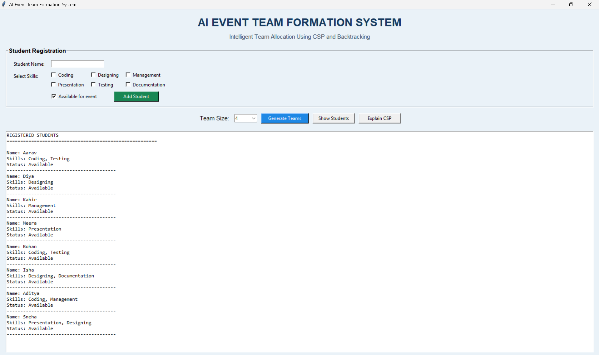
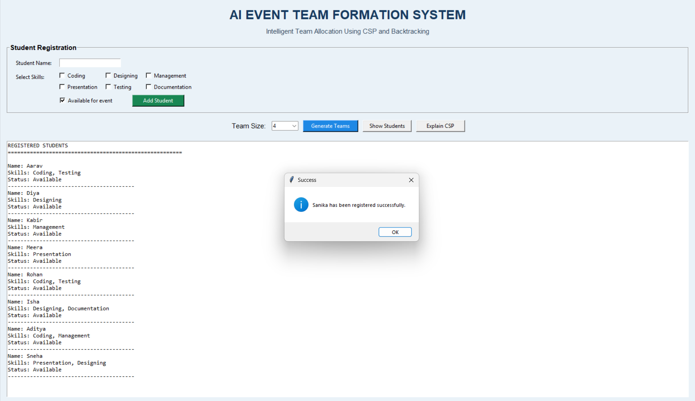
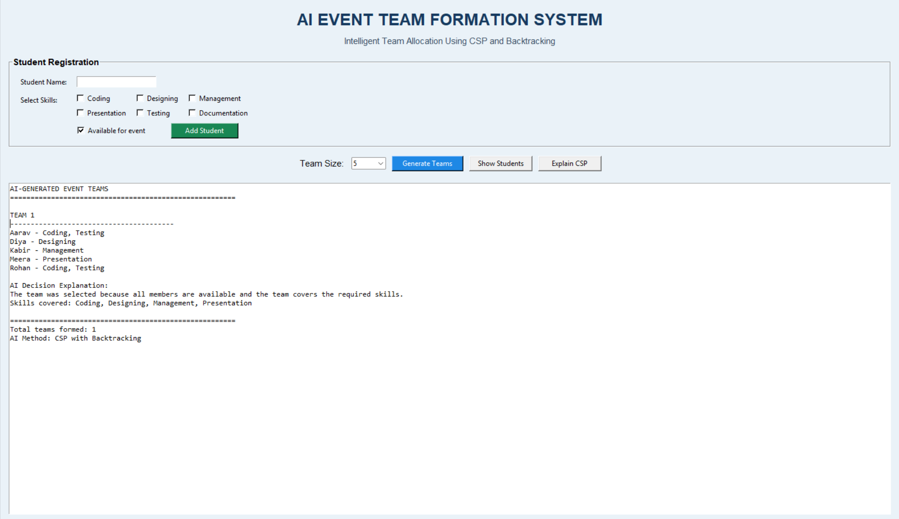
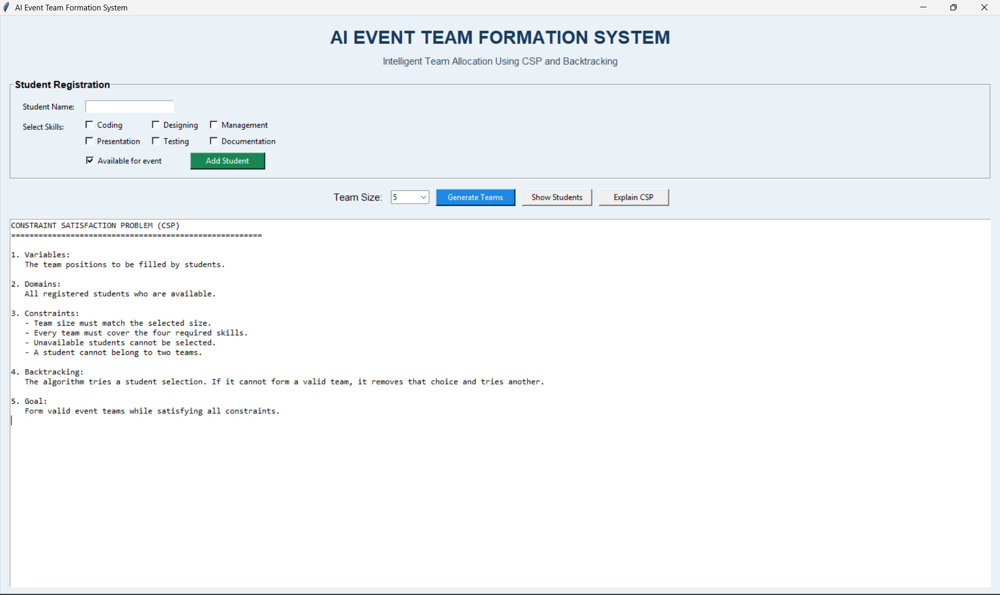

# AI Event Team Formation System

An AI-based application that automatically forms event teams using a **Constraint Satisfaction Problem (CSP)** and the **Backtracking Algorithm**.

## About the Project

Forming teams for college events manually can take time. This project helps organize students into teams based on their skills, availability, team size, and required skills.

The application is developed using Python and Tkinter.

## Features

- **Student Registration:** Add students with their names and skills.
- **Skill Selection:** Select Coding, Designing, Management, Presentation, Testing, and Documentation.
- **Availability Management:** Mark students as available or unavailable.
- **Automatic Team Formation:** Generate teams based on predefined constraints.
- **AI Decision Explanation:** Display why a team satisfies the required conditions.
- **CSP Model:** Explain variables, domains, constraints, and backtracking.

## Technologies Used

- Python
- Tkinter
- Constraint Satisfaction Problem (CSP)
- Backtracking Algorithm
- Visual Studio Code

## Project Structure

```text
AI-Event-Team-Formation/
│
├── main.py
├── csp_solver.py
├── README.md
└── .gitignore
```

- `main.py` — Contains the graphical user interface and application features.
- `csp_solver.py` — Contains the team formation logic using CSP and backtracking.

## Application Screenshots

### 1. Main Interface



### 2. Registered Students



### 3. Generated Teams



### 4. CSP Model Explanation



## How to Run the Project

### Requirements

- Python 3 installed on your computer.
- Tkinter, which is generally included with standard Python installations on Windows.

### Steps

1. Download or clone this repository.
2. Open the project folder in Visual Studio Code.
3. Open the terminal.
4. Run the following command:

```bash
python main.py
```

The application window will open.

## AI Technique Used

### Constraint Satisfaction Problem (CSP)

CSP solves problems by satisfying a set of constraints. In this project, the constraints include team size, student availability, and required skill coverage.

### Backtracking Algorithm

Backtracking tries possible student combinations. If a combination does not satisfy the constraints, the algorithm goes back and tries another combination.

## Applications

- College technical and cultural events.
- Hackathons and coding competitions.
- Student project teams.
- Workshops and volunteer management.

## Future Scope

- Save student records permanently.
- Export generated teams to PDF or Excel.
- Add more team formation constraints.
- Develop a web-based version.


**-Sanika Sutar**

